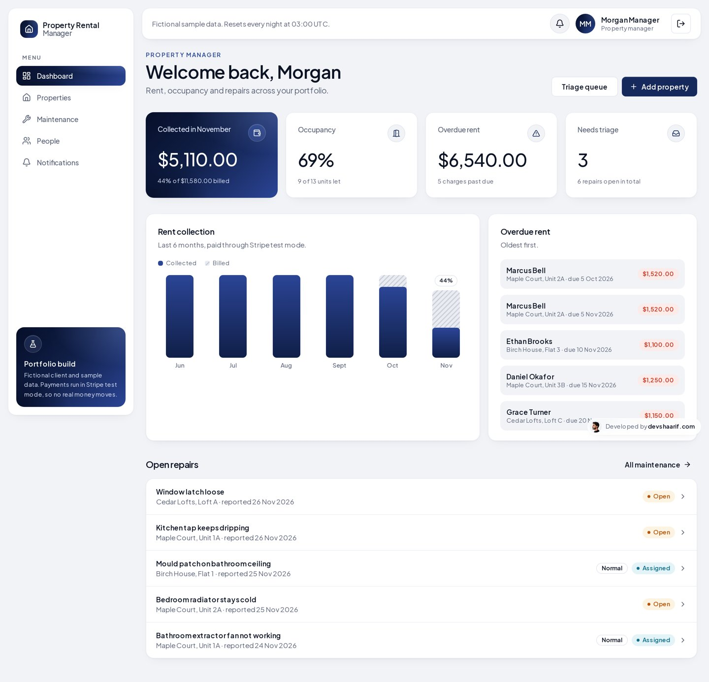
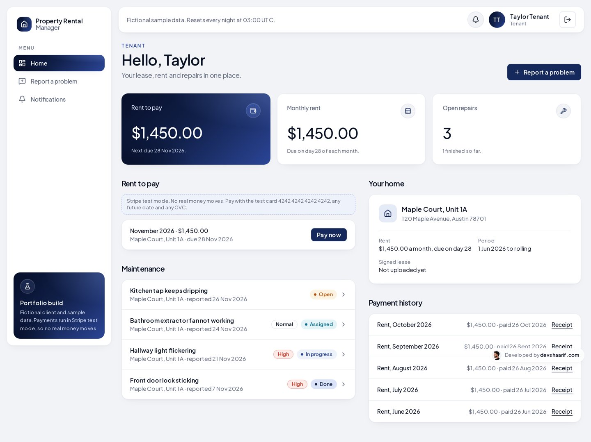
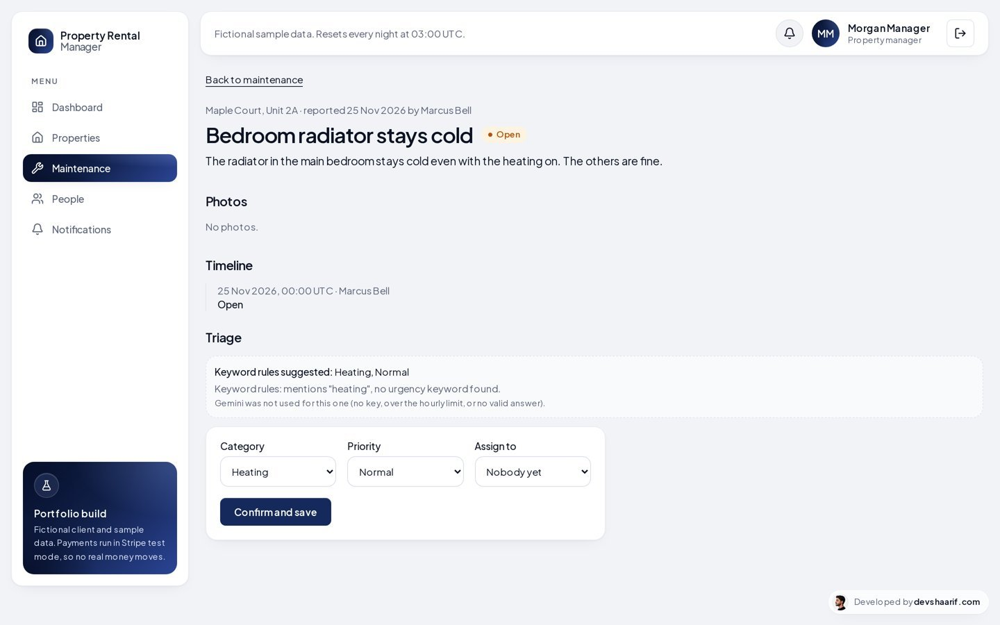
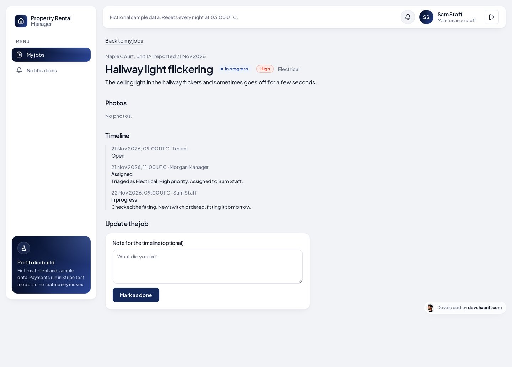
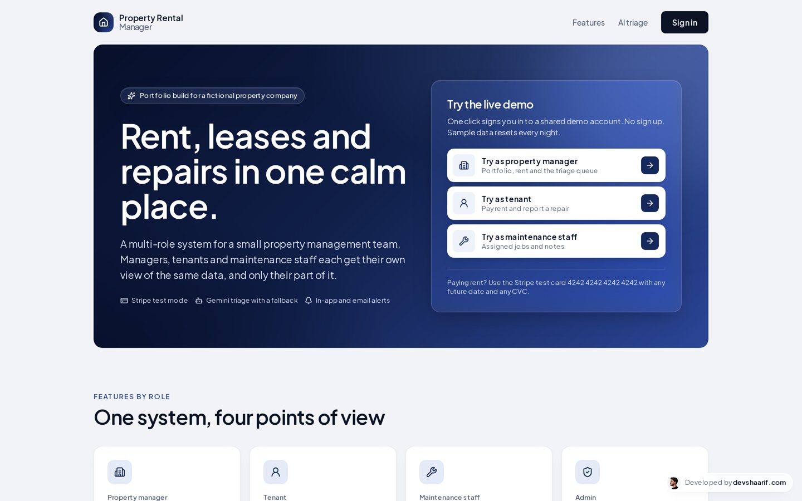
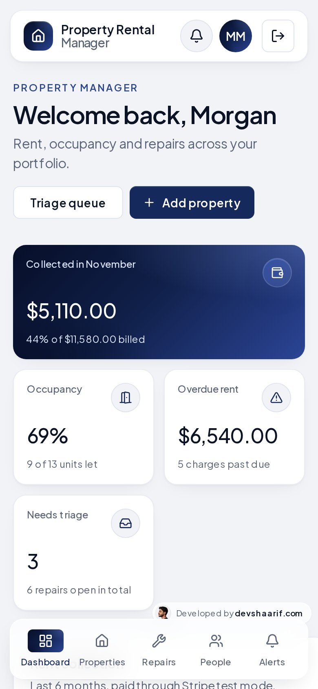
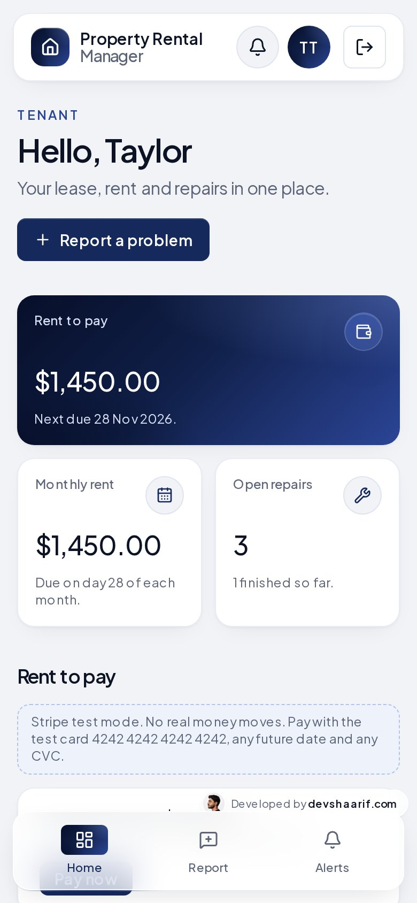
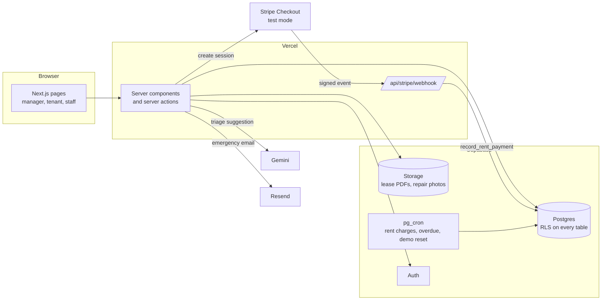
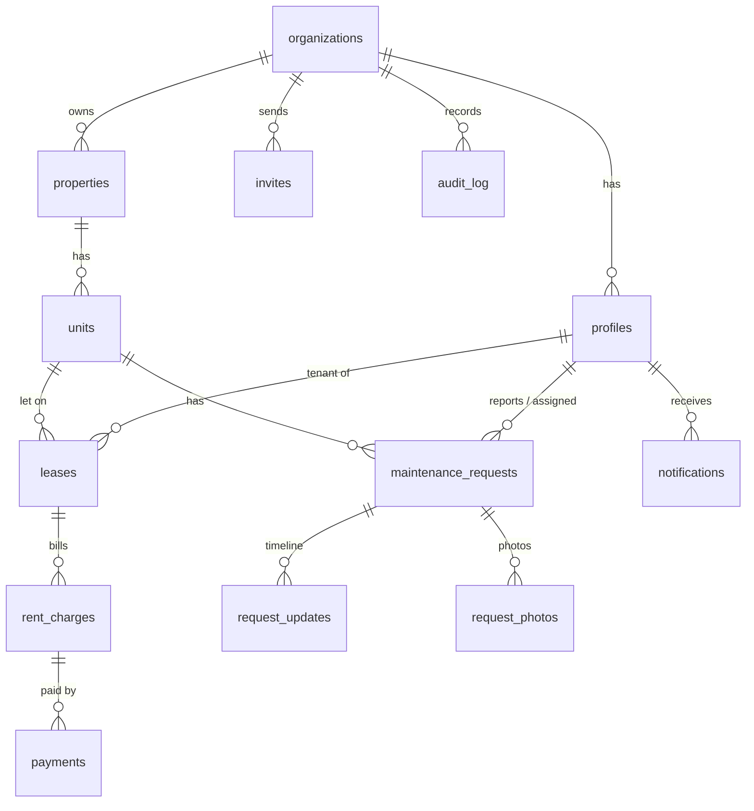

# Property Rental Manager

> **Portfolio build.** Fictional client, sample data, Stripe test mode. Not a real product and no real money moves.

[](https://github.com/devshaarif2030/property-rental-manager/actions/workflows/ci.yml)

**Live demo:** [property-rental-manager-nu.vercel.app](https://property-rental-manager-nu.vercel.app)



## The problem

A small property company runs on spreadsheets, a shared inbox and phone calls. Rent is
chased by hand, nobody knows which repairs are waiting, and tenants cannot see what is
happening with the leak they reported last week.

This app puts it in one place. Managers, tenants and maintenance staff each sign in to
their own view of the same data, and only their part of it. The company, its people and all
numbers in the demo are fictional.

## Try it

Open the [live demo](https://property-rental-manager-nu.vercel.app) and pick a role. One click
signs you in to a shared demo account, no sign up needed.

| Button | What to try |
| --- | --- |
| **Try as property manager** | Dashboard with rent collected, occupancy and overdue rent. Triage a new repair and assign it. |
| **Try as tenant** | See your lease and rent due, pay with Stripe test mode, report a repair with photos. |
| **Try as maintenance staff** | Open your assigned jobs, start one, leave a note, mark it done. |

Paying rent? Use the Stripe test card `4242 4242 4242 4242`, any future date and any CVC.
The demo data resets every night at 03:00 UTC.

## Features by role

| Role | Can do |
| --- | --- |
| **Manager** | Properties, units and leases with signed PDFs. Monthly rent charges and overdue tracking. Triage queue with an AI suggestion to confirm. Invite tenants and staff. |
| **Tenant** | Lease, rent due and payment history in one view. Pay with Stripe Checkout (test mode) and get a receipt. Report a repair with up to three photos and follow its timeline. |
| **Maintenance staff** | Only the jobs assigned to them. Move a job to in progress or done, with notes the tenant can read. Nothing financial. |
| **Admin** | Everything in their organization, including the audit log. Invite managers and admins. |

In-app notifications for new jobs, status changes and emergencies. Emergencies also go out by
email (Resend). Shared demo accounts never get email.

<table>
  <tr>
    <td></td>
    <td></td>
  </tr>
  <tr>
    <td></td>
    <td></td>
  </tr>
</table>

<p align="center">
  
  
</p>

## AI triage: AI helps, a person decides

When a tenant reports a repair, the server asks Gemini for a category and a priority.

1. The request text goes to Gemini (`gemini-flash-lite-latest` by default) with a fixed list of
   categories and priorities.
2. The answer is parsed with a strict Zod schema. Anything that does not match is thrown away.
3. If Gemini is not configured, times out, returns bad output, or the organization has used up
   its hourly AI calls, keyword rules make the suggestion instead. The request is never blocked.
4. The suggestion and where it came from (`ai` or `rules`) are stored on the request.
5. Nothing is acted on until a manager confirms or changes the category and priority and picks
   who does the job.

## Architecture



A tenant never marks rent paid. The app creates a pending payment when Checkout starts, and only
the webhook, after verifying Stripe's signature, records it through a database function that
checks the amount and currency and is safe to call twice.

## Data model



Every business table has `org_id`, and Row Level Security policies scope every read and write to
the signed-in user's organization and role.

## Stack

Next.js 16 (App Router) and React 19, TypeScript strict, Tailwind CSS v4 with shadcn/ui,
Supabase (Postgres, Auth, Storage, pg_cron), Stripe Checkout in test mode, Gemini, Resend,
Zod, Vitest, pgTAP and Playwright. Hosted on Vercel Hobby and Supabase Free.

## Testing

| Command | What it does |
| --- | --- |
| `pnpm lint` | ESLint |
| `pnpm typecheck` | TypeScript strict |
| `pnpm test` | Vitest unit tests |
| `pnpm test:integration` | Sign-in tests against local Supabase |
| `pnpm db:lint` | Lints database functions |
| `pnpm db:test` | pgTAP tests: each role sees only its own rows, the demo reset, rent and payments |
| `pnpm e2e` | Playwright: tenant reports a repair, manager triages it, staff finish it, rent is paid by a signed webhook |
| `pnpm screenshots` | Playwright: the screenshots in this README |

CI runs all of these on every pull request, on a local Supabase with the demo data loaded.
The e2e tests never call Stripe: they sign a test webhook with a fake secret, and the app checks
the signature the same way it does in production.

## Run locally

Requires Node 22, pnpm and Docker.

```bash
pnpm install
cp .env.example .env.local   # fill in values from `supabase status`
pnpm db:start                # local Supabase, applies migrations and the seed
pnpm db:test                 # RLS tests
pnpm dev
```

The local seed creates one fictional organization with a demo account per role:
`admin@demo.test`, `manager@demo.test`, `tenant@demo.test`, `staff@demo.test`, all with the
local-only password `demo-password`. Magic link emails land in Mailpit at http://127.0.0.1:54324.

Gemini, Resend and Stripe keys are optional locally. Without Gemini, triage uses the keyword rules.

To deploy your own copy on free tiers, follow [docs/deploy.md](docs/deploy.md).

## Security notes

- RLS on every table. `anon` has no table access.
- Sign up is closed: accounts are created by invite only. Invite tokens are 32 random bytes,
  stored only as a SHA-256 hash, single use and valid for 7 days. Managers can invite tenants
  and staff; only admins can invite managers or admins (enforced by RLS). Roles come from the
  `profiles` table, never from the JWT, and every protected page re-checks the role on the server.
- Clients cannot write rent charges, payments, notifications or the audit log. Payments are
  recorded only by the verified Stripe webhook using the service role.
- The audit log is insert-only, enforced by a trigger.
- Rent charges are created by a nightly `pg_cron` job (one per active lease per month) and
  marked overdue by a second one. Both run inside Postgres and clients cannot call them.
- Lease PDFs and repair photos live in private Storage buckets under `<org_id>/...`. Files are
  only served through short-lived signed URLs, and uploads are checked for type and size. Repair
  photos are resized and stripped of location data in the browser before upload.
- AI output is never trusted: it is validated with Zod and only ever a suggestion.
- Stripe keys must be test-mode keys. A live key is refused at startup.
- The demo accounts are shared, reset every night, and never receive email.
- No secrets in the repo. `.env.example` holds placeholders only.

---

Portfolio build by Muhammad Shaarif, [devshaarif.com](https://devshaarif.com). Fictional client,
sample data, Stripe test mode.
